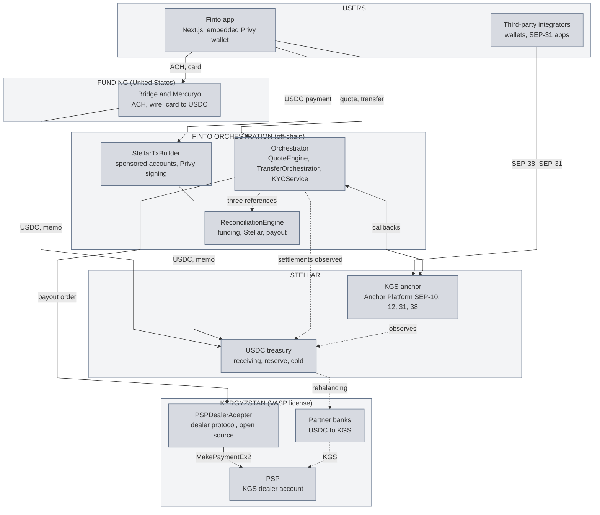
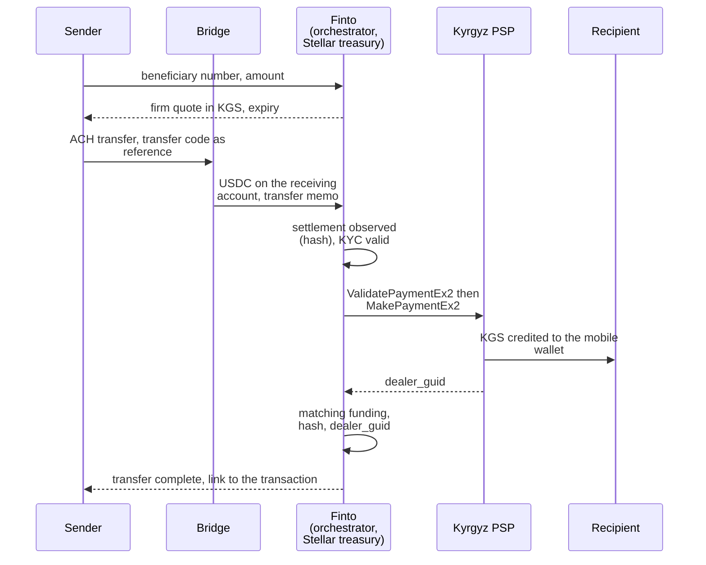

# Technical architecture: Finto, USD to KGS transfers settled on Stellar

**Product:** Finto ([finto.kg](https://finto.kg/en)), an account for international transfers for people from Central Asia living abroad. This document covers the US dollar leg: the sender pays in dollars, settlement happens in USDC on Stellar, the recipient receives Kyrgyz som (KGS) on their mobile wallet within minutes.
**Chain:** Stellar, as the only settlement rail, with Circle's USDC (a native Stellar asset). No contract to deploy: classic payments, memos, multi-signature accounts, sponsored reserves and the SEP standards.
**Integrations from the official list:** Bridge (ACH and wire funding), Mercuryo (card funding), Privy (embedded Stellar wallets), Anchor Platform (KGS anchor, SEP-31 and SEP-38).
**Operator:** Orbit Labs, through its licensed entity Fintopio Virtual Assets LLC (virtual asset service license VA 0097, Kyrgyz Republic), with two partner banks and a licensed local payment service provider (PSP) under contract. Website: [finto.kg/en](https://finto.kg/en).
**Name:** the product was presented as Pulsar until autumn 2026, the name still carried by the application video and the `orlbs` repositories. It now carries the name of its licensed operator, Finto. This document uses Finto throughout.

---

## 1. One page

On the Kyrgyz side we already operate the hardest part of a transfer: the license, the banks, the PSP that credits mobile wallets. What is missing is an entry rail for dollars and a settlement layer anyone can verify. That is what we are building on Stellar.

A sender signs in with an email or a social account: a Privy Stellar wallet is created for them, with no recovery phrase and no XLM to hold. They enter a Kyrgyz phone number and an amount, and get a firm quote in KGS. They pay by ACH transfer (Bridge), by card (Mercuryo) or from a USDC balance they already hold on Stellar. In all three cases the funds land as USDC on our Stellar treasury with a memo that identifies the transfer. Settlement observed on-chain triggers the payout order: our adapter calls the PSP, the recipient is credited, and the transfer closes once its three references are matched: the funding event, the Stellar transaction hash and the PSP payout reference.

The same infrastructure is open to the rest of the network. By deploying the SDF's Anchor Platform in front of our payout rails, Finto becomes a **KGS anchor**: any wallet, any remittance app and any disbursement program in the Stellar ecosystem can get a firm quote (SEP-38) and pay a Kyrgyz beneficiary (SEP-31), with no bilateral agreement and no custom code. No anchor serves the Kyrgyz som on the network today.

**What Stellar gains:** USDC flowing on Stellar for every transfer of a corridor worth over 100 million dollars a year, a new currency reachable over SEP-31 and SEP-38, an open-source adapter for the "dealer" protocol common among Central Asian PSPs, and Stellar wallets created for a diaspora that had none.

## 2. Components

| Component | Role | Status |
|---|---|---|
| **Finto app** (Next.js, PWA) | Sender journey: sign-in, beneficiary, quote, funding method, tracking | Exists, to adapt to Stellar settlement |
| **Privy** (official integration, wallet) | Embedded Stellar wallet by email or social login, key split across enclaves, Ed25519 signing | Exists in the app, to move to Stellar |
| **Bridge** (official integration, on-ramp) | Per-sender ACH and wire virtual account, hosted KYC, conversion to USDC settled on Stellar | To integrate |
| **Mercuryo** (official integration, on-ramp) | Card payment widget, USDC on Stellar within seconds, tiered KYC | To integrate |
| **QuoteEngine** (off-chain) | Firm USDC to KGS quote with expiry, SEP-38 semantics, one engine for the app and the anchor | To build |
| **TransferOrchestrator** (off-chain) | Transfer state machine; releases the payout on observed on-chain settlement and valid KYC, never otherwise | To build |
| **KYCService** (off-chain) | Recipient KYC (VASP obligation) at SumSub, SEP-12 data model, share tokens with Mercuryo | Exists; SEP-12 format, share tokens and structural enforcement to build |
| **StellarTxBuilder** (off-chain) | Builds Stellar transactions, gets them signed by Privy and submits them: sponsored account and trustline, USDC payments, fee-bump | To build |
| **TreasuryService** (off-chain and Stellar accounts) | Three USDC accounts (receiving, reserve, cold), memo attribution, limits, rebalancing to the banks | To build |
| **ReconciliationEngine** (off-chain) | Three-way matching, daily report, exceptions queue, public evidence package | To build |
| **PSPDealerAdapter** (off-chain, open source) | The PSP's SOAP dealer protocol: validation then payment, idempotency, tracking by `dealer_guid` | Calls exist; idempotency, tracking, stuck queue and release to build |
| **Anchor Platform** (official integration, SDF) | SEP-1, 10, 12, 38 and 31; Finto business server behind the callbacks; the platform's Stellar observer | To deploy |
| **PSP and partner banks** (Kyrgyzstan) | Prefunded KGS dealer account; USDC to KGS conversion under the VASP license | Exist, under contract |
| **USDC** (Circle) | Settlement asset: code `USDC`, issuer `GA5ZSEJYB37JRC5AVCIA5MOP4RHTM335X2KGX3IHOJAPP5RE34K4KZVN` | Exists |

## 3. Overview

## 4. Design principles

1. **Stellar is the only settlement ledger.** No payout order leaves for the PSP without a USDC payment observed on-chain, whatever the funding method. There is no other chain and no treasury outside Stellar in this system.
2. **One memo per payment, three references per closure.** Every incoming payment carries a memo that ties it to a transfer (the transfer id for wallet and card payments, the sender id for Bridge settlements, completed by Bridge's payment reference); a transfer is complete when the funding event, the Stellar hash and the PSP reference are linked. The hash is the pivot: public, verifiable by anyone.
3. **A firm quote, honored.** The quote binds Finto until it expires. The same QuoteEngine serves the app and the anchor's SEP-38 quotes, with a cap on open quotes per account, since a quote reserves hedging capacity.
4. **At most one documentary KYC per person.** Compliance is a precondition of the state machine, not a rule written in a document: without a valid compliance status, the payout order is not issued.
5. **Existing building blocks, our own code only where nobody provides it.** Bridge, Mercuryo and Privy carry funding and wallets; the Anchor Platform carries the SEPs; we write the orchestration, the reconciliation and the PSP adapter.
6. **Everything is replayable.** Webhooks, Stellar submissions and payout orders are idempotent on the transfer id: a replayed step or a restarted service never pays twice.

## 5. The journey of a transfer

For a sender paying **by card** (Mercuryo) or **from a USDC balance** already held in their Privy wallet, the two Bridge steps are replaced by an immediate USDC payment to the receiving account, with the same memo. The rest of the journey is identical: the three funding methods converge on the same on-chain settlement event. The journey of a **third-party integrator** over SEP-31 is described in §10: it enters through the Anchor Platform and joins the same orchestrator from the observed settlement onwards.

## 6. Funding: Bridge and Mercuryo

Two independent entry paths, one settlement destination. Neither adds a corridor, a payout provider or a separate compliance journey.

### 6.1 Bridge: the economical path (ACH and wire)

For each sender we create a Bridge customer (`POST /v0/customers`) and Bridge issues a dedicated ACH and wire virtual account. The sender wires dollars with the transfer code as payment reference. KYC is done by Bridge, through its hosted link, once at onboarding: Finto stores no US-side identity document, only the verification status and the customer reference (§11).

Bridge converts the dollars to USDC and settles **directly on our Stellar receiving account**. The destination memo is set once per virtual account, hence per sender; attribution to the transfer uses that memo and the payment reference Bridge reports together with the transfer code. Stellar is one of the chains Bridge serves natively: there is no bridging step anywhere in the flow. Bridge webhooks advance the state machine, but the final confirmation is always **the observed Stellar transaction**, never the webhook (§12). A first ACH transfer takes one to three business days: that is the bank's delay, not settlement's; the card path addresses it.

### 6.2 Mercuryo: the express path (card) and redundancy

The Mercuryo widget (iFrame) allows a card payment that delivers USDC on Stellar in about fifteen seconds: this is the answer for a first-time sender who cannot wait for ACH. KYC is tiered: below the provider's no-document threshold (in the region of €300, which covers the average transfer of about $200), a sanctions check only; above it, a SumSub verification, which our own KYC recognizes through SumSub share tokens (§11).

If Bridge is unavailable, the corridor stays open through the card: both paths end on the same receiving account with the same memo scheme, so everything downstream is indifferent to the funding method. The card is presented as the express option; its extra cost is shown at quote time.

## 7. Wallets: Privy and StellarTxBuilder

Privy provides non-custodial embedded wallets: the sender signs in with an email or a social account, a Stellar Ed25519 wallet is created for them, the key is split across enclaves and reassembled only for the duration of a signature; it is exportable. No recovery phrase, no signing prompt.

For Stellar, Privy's support is at **tier 2**: wallet creation, address derivation and raw Ed25519 signing, but no transaction building or submission and no fee handling. So we write a dedicated module, **StellarTxBuilder**:

- **A new Stellar account does not exist on-chain until it is funded.** At the sender's first transfer, whatever the funding path (Bridge, Mercuryo or an existing USDC balance), the platform account sponsors the creation of the account and its USDC trustline in a single transaction (`BeginSponsoringFutureReserves`, `CreateAccount`, `ChangeTrust`, `EndSponsoringFutureReserves`), signed by the platform account and by the new wallet: the sender never holds XLM, neither for reserves nor for fees.
- **Payments** in USDC to the receiving account with the transfer memo, wrapped in a fee-bump paid by the platform account. The operation is signed by the Privy wallet (the transaction hash is submitted to the enclave), the fee-bump by our fee key.
- **Submission** through Stellar RPC, with sequence management on the sender's account and the platform account, idempotency by transfer id and handling of the statuses (`PENDING`, `TRY_AGAIN_LATER`, `DUPLICATE`, `ERROR`): no failure is concluded without a `getTransaction` confirming it. Incoming payments are observed through the Horizon payments stream, with a persistent cursor and catch-up on restart.
- A single internal interface, `build_and_submit(intent) → tx_hash`, consumed by the TransferOrchestrator: wallet mechanics are isolated from business logic. The fee-bump could be delegated to OpenZeppelin Relayer; we keep it in this module because it also handles sponsored reserves and the platform account's sequence.

This module also opens the **direct cash-out** case: a user who already holds USDC on Stellar (received from another app) sends it to a Kyrgyz number without any on-ramp. This is exactly the flow third-party integrators get over SEP-31 (§10).

## 8. Stellar treasury: the own-book model

A remittance operator does not move money transfer by transfer from one country to the other: it links **two local legs through a treasury**. Here the treasury is a set of Stellar accounts, and it is what counts.

| Account | Role | Signing | Custody policy |
|---|---|---|---|
| **Receiving** | Receives every settlement (Bridge, Mercuryo, Privy wallets, SEP-31 senders), each with its memo; swept daily to the reserve above a cap | One signer held by the custody service (HSM module), never in an environment variable | Pays only to the reserve |
| **Reserve** | Funds the rebalancing to partner banks; receives the sweeps | Two of three signers, one human approval above a threshold | Destinations limited to the partner banks' addresses, daily cap |
| **Cold** | Treasury surplus | Three of five signers, offline keys | Manual movements only |

The key that signs the anchor's SEP-10 challenges (§10) is distinct from every treasury key: its compromise blocks authentication until rotation, it gives access to no funds.

**Attribution.** Every incoming payment is identified by the triple asset (code `USDC` and the Circle issuer, never the code alone), amount and memo. A payment with no memo, an unknown memo, another asset or an unexpected amount is never paid out: it goes to the exceptions queue with a refund path, to the sender's wallet or through the funding provider (§12). The destination limits on the accounts are a custody-service policy, enforced before signing, not a property of the Stellar account.

**Payout trigger.** The TransferOrchestrator issues the KGS payout order when the USDC settlement is observed on-chain, and only then, on all three funding paths; provider webhooks inform, they trigger nothing.

**FX.** The QuoteEngine locks a USDC to KGS rate per transfer; the treasury absorbs the rate movement between quote and rebalancing, within configured exposure limits that trigger the rebalancing.

**Rebalancing loop.** Accumulated USDC is periodically converted to KGS through the **partner banks, under our VASP license**, to refill the dealer account at the PSP. Rebalancing operations are Stellar transactions from the reserve account to bank addresses on a closed list: the liquidity cycle is verifiable on-chain on the USDC side.

Earlier iterations of the product held the USDC treasury on another chain; that component is gone. There is **no Ethereum or other-chain component** in this system. The Stellar treasury is not an optional mirror, it is the only settlement ledger.

## 9. KGS payout: PSPDealerAdapter

The licensed Kyrgyz PSP exposes a SOAP 1.1 "dealer" protocol; Finto operates there as a dealer, paying from a prefunded KGS account, with no recipient onboarding at the PSP.

- **Two-phase payment**: `ValidatePaymentEx2` (beneficiary number and amount) then `MakePaymentEx2` (execution). A payment registry in the database, keyed by transfer id, guarantees that a replayed order produces a single payment.
- **Polling-based confirmation**: the PSP has no webhook; the adapter tracks each payment by `dealer_guid`, the PSP-side reference, with an increasing delay between attempts and a stuck-payments queue for manual review and alerting.
- **One interface, two front doors**: `payout(phone, amount_kgs, transfer_id) → dealer_guid`, called identically by the app journey and by the anchor's SEP-31 flow (§10).
- **Released as open source** (Apache-2.0 license) with its documentation: the dealer protocol is a common pattern among Central Asian and CIS PSPs, and any Stellar integrator connecting to one will be able to reuse the adapter.

## 10. KGS anchor: Anchor Platform

This is the centerpiece. Our VASP license and our bank and PSP partners are exactly the regulated capability an anchor requires; this project wraps them in the SDF's **Anchor Platform** (Kotlin and Spring Boot, PostgreSQL, Kafka, Docker containers; version 5 at the time of writing, November 2026) in the **receiving** anchor role, so that KGS becomes reachable by any network participant.

| Standard | What we expose | What sits behind it |
|---|---|---|
| **SEP-1** | `stellar.toml` at `finto.kg/.well-known/`, over HTTPS, open CORS: currencies (USDC with its issuer), endpoints, the legal entity holding the license, `SIGNING_KEY` | A dedicated signing key, separate from the treasury |
| **SEP-10** | Authentication of third-party wallets and anchors through a signed challenge | Rate limiting per address and per account, documented key rotation |
| **SEP-12** | Exchange of the beneficiary's KYC data, polling and callbacks, deletion on request (`DELETE /customer`) | KYCService, same rules as the app (§11) |
| **SEP-38** | Indicative and firm USDC to KGS quotes, with expiry | QuoteEngine, through the platform's `GET /rate` callbacks; cap on open quotes per account |
| **SEP-31** | Receipt of a cross-border payment: the sending anchor creates the transaction, receives the account and memo to pay, sends the USDC; we pay the beneficiary in KGS | TransferOrchestrator and PSPDealerAdapter, through the business server |

**Business server mechanics.** The platform owns the transaction state machine; our business server owns the money. Three surfaces: the platform's signed **callbacks** (rates, KYC, events), which we verify before answering; the **JSON-RPC** calls we issue to move a transaction forward (`notify_offchain_funds_sent` after the PSP payout, `notify_refund_sent` if a flow fails); the **Kafka events**, delivered at least once, consumed by an idempotent handler keyed on transaction id and step, with forward-only state transitions. For SEP-31 flows, **the Anchor Platform's Stellar observer is the source of truth** for "funds received": the TreasuryService does not decide in parallel, it reconciles at intervals. For app flows, it is the other way round.

**Validation.** The `stellar-anchor-tests` suite is run on every enabled SEP before any opening, then on a regular schedule in production against a test account.

**Why it matters beyond Finto.** Any remittance app to Central Asia, any wallet wanting a KGS cash-out, any aid disbursement program targeting Kyrgyzstan gets a KGS off-ramp compliant with the standards it already implements. Our regulated capability becomes a network resource, and the business model gains a B2B line (§13).

## 11. Compliance and KYC

One principle: **each person completes at most one documentary KYC**, and compliance is structural, enforced by the state machine.

| Flow | KYC performed by | When | Finto's role |
|---|---|---|---|
| Sender, ACH path | **Bridge** (hosted link) | Once, at onboarding | Stores the status and the customer reference, never the documents |
| Sender, card below about €300 | **Mercuryo** (sanctions check) | Per transaction, no document | None |
| Sender, card above the threshold | **SumSub** (Mercuryo's provider) | Once | Recognised through SumSub share tokens |
| Recipient (Kyrgyzstan) | **KYCService** (SumSub) | Once, at first payout | VASP license obligation; SEP-12 data model |
| Third-party SEP-31 flows | The sending anchor collects, transmits over **SEP-12** | Per the standard | Validated against the same VASP rules |

- **SumSub as the pivot provider.** Our VASP-side KYC runs at SumSub under a reusable KYC agreement. Since Mercuryo also verifies through SumSub, verifications are recognized both ways through share tokens: a person verified by Finto is not re-verified by Mercuryo.
- **Structural enforcement.** The TransferOrchestrator refuses to issue a payout order until (a) the sender's funding path reports a valid compliance status and (b) the recipient's KYC record is valid and unexpired. These are preconditions of the state machine, logged in an append-only event log.
- **Sanctions screening** at onboarding and on every transaction above the applicable threshold, with periodic rescreening; **Travel Rule** for SEP-31 flows received from regulated counterparties above the jurisdiction's threshold; documented data retention and deletion on request through `DELETE /customer`.
- **Known edge case.** A card sender above the SumSub threshold who later switches to ACH will also complete Bridge's KYC: Bridge's delegated KYC model only exists in the European Economic Area. A marginal case, accepted.
- **Outside the funded scope**: the VASP license, the banking agreements and the regulatory filings are operating prerequisites held by our licensed entity; no deliverable depends on obtaining a new license or partnership (§15).

## 12. Reconciliation and public evidence

The system is designed so that **every completed transfer is provable from public data**. This is both an operating requirement of the own-book model and the evidence we commit to in the milestones.

Every transfer closes on three references linked by the transfer id: the funding event (Bridge webhook id, Mercuryo transaction id or wallet payment), the **Stellar transaction hash** (USDC payment to the receiving account, transfer memo), which is public, and the PSP's `dealer_guid` reference. A transfer is `COMPLETED` only when all three are matched; any discrepancy (funding without settlement, settlement without payout, payout without settlement) goes to an exceptions queue with an alert, and each class of discrepancy has its procedure: refund of an orphan payment (wrong memo, wrong asset, payment before KYC) to the sender's wallet or through the funding provider, retry of a stuck PSP payout, halt of new payouts if the gap exceeds rounding.

A **daily report** establishes: sum of funding = sum of on-chain settlements = sum of payouts + treasury change, with an explorer link per settlement. These reports and a **public evidence page** (transaction links, reports for the period) are what we publish at every tranche. A third party can re-derive them from the public history of the treasury accounts and an export of the transfer id and `dealer_guid` pairs, with the verification script published in the repository, without any access to our systems.

## 13. Business model

Two revenue lines on one set of rails.

**B2C (app).** An all-in price of **1.5%** for the sender, when the global average cost of a transfer is above 6% (World Bank, Remittance Prices Worldwide). On the average transfer of about $200: about $3 of revenue; direct costs: Bridge conversion fee, PSP payout fee, FX hedging reserve; Stellar settlement cost negligible (under a thousandth of a dollar). Card payments carry the Mercuryo surcharge, shown at quote time as the express option.

**B2B (KGS anchor).** A per-transaction margin, built into the SEP-38 quote served to third-party SEP-31 senders. Zero acquisition cost, since integrators arrive through standards discovery; the volume adds up on payout infrastructure whose fixed costs the B2C business already carries.

**Corridor context.** Transfers from the United States to Kyrgyzstan exceed 100 million dollars a year according to the National Bank of the Kyrgyz Republic (2025); the Chicago diaspora is our first market. The strategic value lies in the anchor's B2B line and in the corridor extension (§15), both built on the same rails.

## 14. Security: STRIDE threat model and monitoring

Attacker assumption: they control the arguments, the order and the timing of any request or transaction, every account except those that sign, can replay a webhook or an event, and can shape the state of our queues.

| STRIDE | Threat | Answer |
|---|---|---|
| **Spoofing** | Fake Bridge or Mercuryo webhook, fake platform callback, fake wallet at authentication | Signatures verified on every webhook and callback; SEP-10 through a signed challenge; SEP-10 key distinct from the treasury; PSP credentials confined to the adapter |
| **Tampering** | Payment in another asset or with a diverted memo; SEP-31 amount different from the quote; manipulated rate | Attribution by asset (code and issuer), exact amount and memo; SEP-31 transaction bound to an unexpired firm quote; refusal and exceptions queue otherwise |
| **Repudiation** | Dispute of a payout or a settlement | Append-only event log, public Stellar hashes, daily reports re-derivable by a third party |
| **Information disclosure** | Personal data on-chain, secrets in code | The memo is an opaque id; no personal data on-chain; identity documents never stored on the US side; secrets in a dedicated manager, documented rotation |
| **Denial of service** | Bursts on `GET /auth` and `POST /quote`, PSP no longer answering, Kafka consumer lagging | Rate limiting per address and per account, cap on open quotes, increasing delay and stuck-payments queue, alert on Kafka lag |
| **Elevation of privilege** | Compromise of a treasury key, rebalancing to a foreign address | Three custody tiers, rebalancing destinations on a closed list, human approval above a threshold, key rotation, no raw key in an environment variable |

**Monitoring.** Alert when a transaction stays too long in an intermediate state (settlement received with no payout order within five minutes, PSP payout with no `dealer_guid` within five minutes, SEP-31 transaction waiting for funds beyond an hour); receiving and reserve account balances against the payouts expected over 24 hours; stuck-payments queue; health and latency of the SEP endpoints; SEP-10 signature failure counter; `stellar-anchor-tests` run on a regular schedule in production. A monitoring plan and a runbook (orphan funds, key compromise, PSP unavailable, SEP-10 rotation) accompany the production launch.

## 15. Scope and next steps

**What we build.** TreasuryService, QuoteEngine, TransferOrchestrator, ReconciliationEngine, StellarTxBuilder, PSPDealerAdapter (open source), the Bridge, Mercuryo and Privy integrations, the Anchor Platform deployment with SEP-1, 10, 12, 38 and 31, the production launch and the evidence package defined in the milestones.

**Out of scope.** The VASP license, the banking agreements and the PSP contract, already held by our licensed entity; the EUR and GBP account legs of Finto, which keep their current rails; any corridor that does not end in Kyrgyzstan; any acquisition metric in tranche 1 or 2.

**Next, with no funding requested.** The **EUR to KGS** corridor: Bridge serves SEPA natively, the same rails serve European senders with no architectural change. **MoneyGram Ramps** for cash deposits at an agent, once a commercial agreement is in place. **Expansion across Central Asia** by replicating the anchor pattern country by country, as regulatory coverage is acquired.
