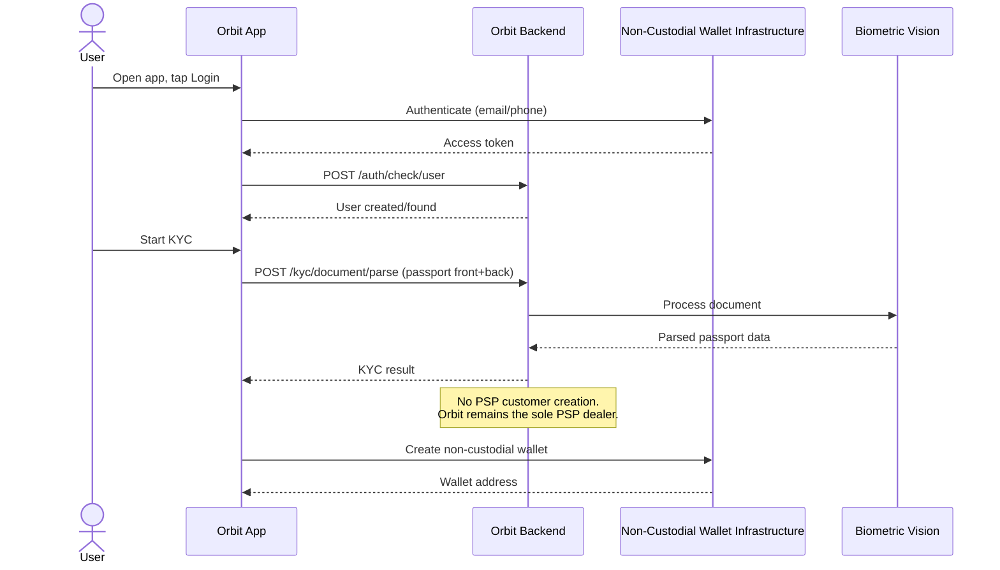
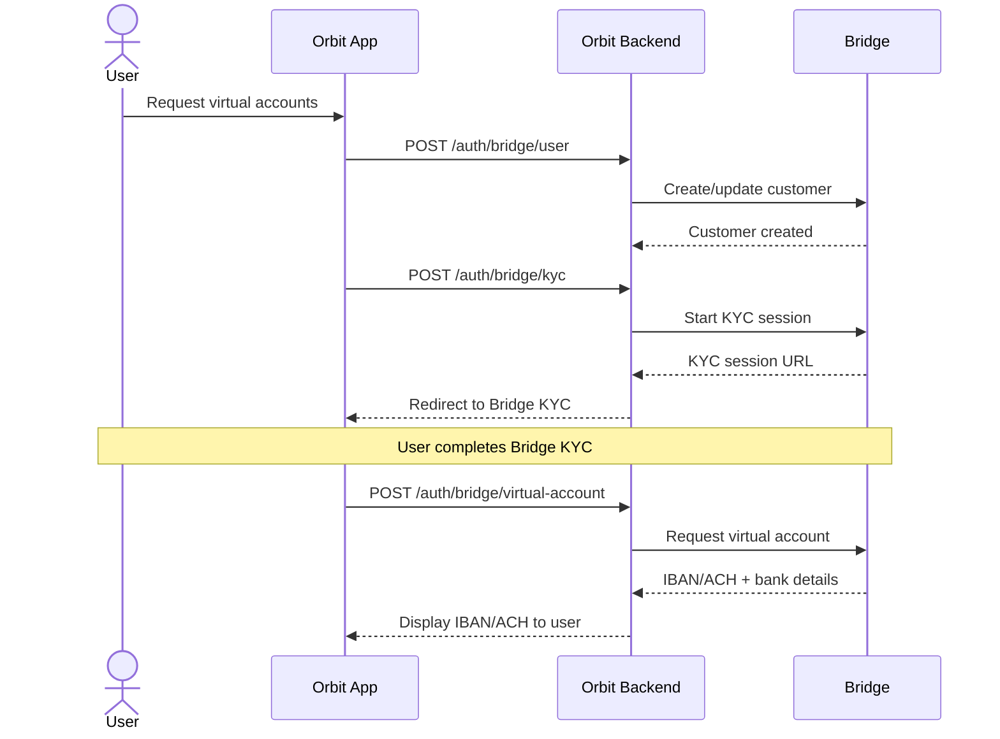
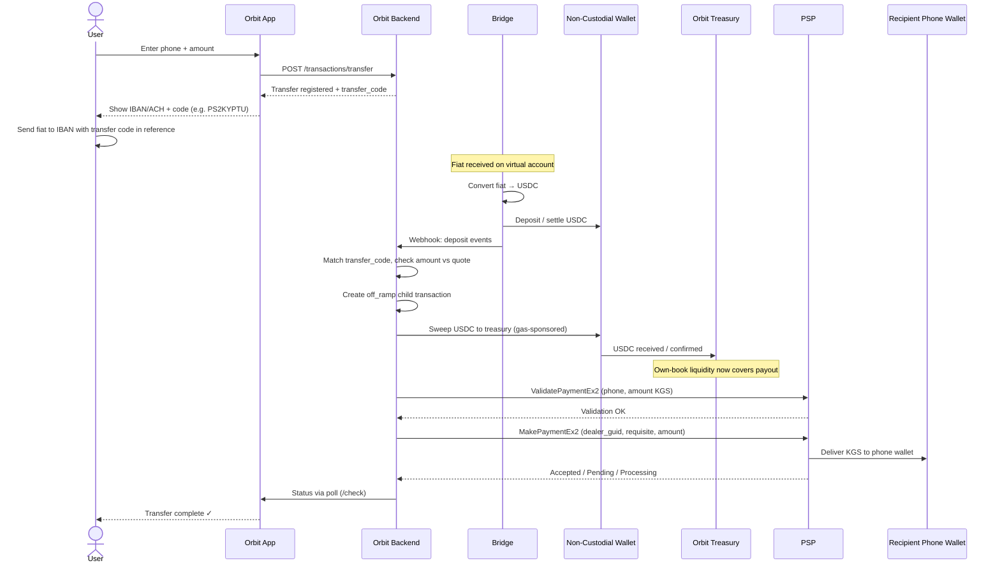
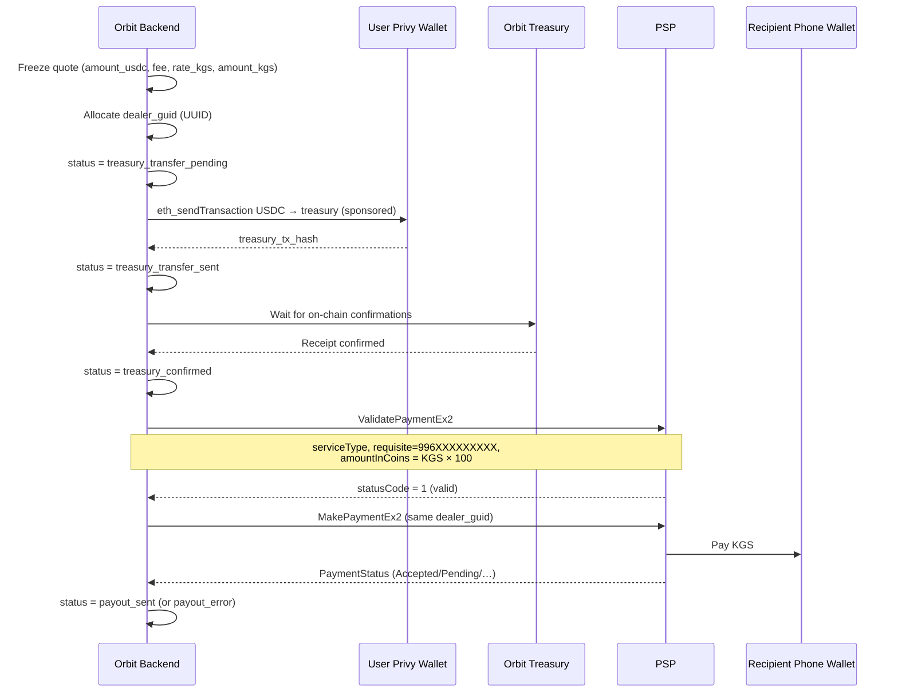

# TMD: Orbit × PSP Own-Book Offramp Integration

## 1. Overview

This document describes the technical integration that enables Orbit cross-border
money transfers from ACH/IBAN (and wallet USDC) to Kyrgyz recipients. Orbit
integrates directly with a **PSP** and manages **its own book** (treasury
liquidity) for USDC → KGS conversion and payout.

### 1.1 Goals

- Enable Orbit users to on-ramp fiat via virtual IBAN/ACH accounts
- Hold and settle USDC liquidity on Orbit’s treasury (own book)
- Off-ramp KGS to recipient Kyrgyz phone wallets via the PSP dealer protocol
- Support immediate wallet withdrawals and Bridge transfer-code remittances

### 1.2 System Participants

- **Orbit App** — frontend (Next.js PWA) + backend (FastAPI)
- **Non-Custodial Wallet Infrastructure** — authentication and embedded wallets (Privy)
- **Bridge** — fiat-to-crypto on-ramp, IBAN/ACH virtual account generation
- **Biometric Vision** — KYC document processing service
- **Orbit Treasury (Own Book)** — Orbit-controlled USDC liquidity pool used for all off-ramps
- **PSP** — Kyrgyz dealer payment provider; pays KGS to phone requisites

### 1.3 Own-Book + PSP Model

| Dimension | Model |
| --- | --- |
| Off-ramp venue | Shared Orbit dealer account at the PSP |
| Liquidity | Orbit treasury / own book |
| FX | Orbit-configured USDC→KGS rate, frozen per transaction |
| Payout rail | PSP dealer payment to phone (`996XXXXXXXXX`) |
| Customer onboarding at PSP | No per-user PSP customer; Orbit is the dealer |
| PSP callbacks | No PSP webhook; Orbit tracks payouts by `dealer_guid` |

---

## 2. User Onboarding Flow

### 2.1 Account Creation (Orbit)

When a user signs up through the Orbit app:

1. User authenticates via Non-Custodial Wallet Infrastructure (email/phone/social login).
2. Orbit backend creates a user record.
3. User completes KYC via Biometric Vision:
   - Passport front/back scan
   - Video liveness check (Biometric Vision session)
4. No PSP customer account is created for the user. The PSP sees Orbit only as a
   dealer; recipient identity for payout is the phone requisite.

### 2.2 Non-Custodial Wallet Provisioning

After successful onboarding, the Non-Custodial Wallet Infrastructure creates a
non-custodial wallet for the user (Ethereum and/or Stellar depending on product
routing). The wallet address(es) are stored and associated with the user’s account.

### 2.3 Virtual Account Generation (Bridge KYC)

If the user passes Bridge onboarding, they receive:

- **IBAN number** (for EUR/international transfers)
- **ACH account number** (for USD transfers)

These are generated through Bridge’s payment infrastructure.

---

## 3. Cross-Border Transfer Flow (Own Book + PSP)

### 3.1 High-Level Steps

1. **User initiates transfer** — enters recipient phone number and amount in the Orbit app.
2. **Orbit freezes a quote** — USDC amount, fee, KGS rate, and target KGS are stored on the transfer row.
3. **User sends fiat to IBAN/ACH** — user transfers money to their assigned virtual account, embedding Orbit’s transfer code (e.g. `PSxxxxxx`) in the payment reference.
4. **Bridge converts fiat → USDC** — funds land, convert to USDC, and settle toward Orbit’s treasury / user wallet path.
5. **Webhook notification** — Bridge notifies Orbit backend; deposit is matched to the transfer code.
6. **Own-book settlement** — USDC is confirmed against Orbit treasury liquidity (Ethereum sweep from user wallet, or Stellar pooled treasury deposit).
7. **PSP payout** — Orbit validates and executes a dealer payment (`ValidatePaymentEx2` → `MakePaymentEx2`) to the recipient phone.
8. **Completion** — transfer marked completed when the PSP accepts the payout (in-flight statuses).

### 3.2 Immediate Wallet Off-Ramp

Users with USDC already in their non-custodial wallet can withdraw without a new
IBAN deposit:

1. App calls `POST /api/v1/transactions/off-ramp` with `amount_usdc` + `phone_number`.
2. Backend freezes the quote and starts the treasury → PSP pipeline.
3. App polls `POST /api/v1/transactions/{id}/check` until a terminal status.

---

## 4. Sequence Diagrams

### 4.1 Onboarding (No Per-User PSP Account)



### 4.2 Virtual Account Generation (IBAN/ACH)



### 4.3 Cross-Border Transfer (Full Flow — Own Book + PSP)



### 4.4 Own-Book Off-Ramp via PSP (Detailed)



---

## 5. API Contracts

### 5.1 Orbit Backend → PSP (Dealer Protocol)

Transport: SOAP 1.1 over HTTPS (`{PSP_API_BASE_URL}/API.asmx`), protocol
“Протокол обмена с дилерами услуг” v1.5.

Auth layers:

1. HTTP Basic
2. Body `login` + `passwordMD5`
3. `terminalId`
4. `signature` = MD5(concatenated params + SignatureKey)

#### Validate Payment

```
ValidatePaymentEx2
```

Conceptual request fields:
```json
{
  "login": "<dealer_login>",
  "terminalId": 12345,
  "serviceType": "<PSP_SERVICE_TYPE>",
  "requisite": "996555123456",
  "amountInCoins": 895000,
  "dealer_guid": "8f2c1a6e-4b9d-4e2a-9c11-0a1b2c3d4e5f"
}
```

Notes:

- Validation is mandatory before payment and expires after ~30 minutes.
- Amounts are in tyiyn (`amountInCoins = KGS * 100`).
- `dealer_guid` is Orbit’s unique payment id (used for reconciliation).

#### Make Payment

```
MakePaymentEx2
```

Uses the same `dealer_guid` / requisite / amount after a successful validation.
In-flight success statuses: `Accepted`, `Pending`, `Sending`, `Processing`.

#### Get Payment Status

```
GetPaymentStatusEx
```

Polled / run from ops tooling by `dealer_guid` when follow-up is needed.
The PSP does not push payout-complete webhooks to Orbit.

### 5.2 Bridge → Orbit Backend (Deposit Webhooks)

Bridge deposit events are matched to transfers by normalized
`transfer_code` and customer ownership. On successful USDC settlement Orbit
creates an `off_ramp` child and starts the treasury → PSP pipeline.

### 5.3 Orbit App ↔ Orbit Backend (Active Product APIs)

#### Quote

```
GET /api/v1/transactions/quote
```

#### Create Transfer (IBAN/ACH remittance)

```
POST /api/v1/transactions/transfer
```

Request:
```json
{
  "currency": "EUR",
  "amount": "100.00",
  "phone_number": "+996555123456"
}
```

Response (shape):
```json
{
  "id": 101,
  "type": "transfer",
  "status": "awaiting_deposit",
  "transfer_code": "PS2KYPTU",
  "amount_usdc": "95.000000",
  "fee_usdc": "0.240000",
  "total_usdc": "95.240000",
  "rate_kgs": "87.000000",
  "amount_kgs": "8265.00",
  "phone_number": "996555123456"
}
```

#### Create Off-Ramp (wallet withdraw)

```
POST /api/v1/transactions/off-ramp
```

Request:
```json
{
  "amount_usdc": "100.00",
  "phone_number": "+996555123456"
}
```

#### Poll / Resume

```
POST /api/v1/transactions/{id}/check
```

Resumes crash-safe pipeline states and returns the latest transaction snapshot.

---

## 6. Data Model

### 6.1 `transactions` (unified ledger)

One table covers remittance intent and off-ramp execution (`type`).

**transfer rows**

- `transfer_code` — short code embedded in wire reference (`PS` + 6 chars)
- `currency`, `source_amount` — what the sender pays (e.g. EUR)
- Quote: `amount_usdc`, `fee_usdc`, `total_usdc`, `rate_kgs`, `amount_kgs`
- `phone_number` — recipient, normalized to `996XXXXXXXXX`
- Bridge fields: `bridge_deposit_id`, `received_usdc`, `bridge_exchange_rate`, `deposit_tx_hash`
- Status: `awaiting_deposit` → `deposit_matched` → `completed` (or `review` / `canceled`)

**off_ramp rows**

- `parent_id` — optional link to the funding transfer
- Treasury leg: `chain`, `privy_wallet_id`, `treasury_address`, `treasury_tx_hash`, `treasury_confirmed_at`
- PSP leg: `dealer_guid`, `psp_payment_status`, `psp_message`
- Status: `pending` → `treasury_transfer_pending` → `treasury_transfer_sent` → `treasury_confirmed` → `payout_sent` (or `payout_error` / `review`)

Quote inputs (rate/fee) are frozen at creation so later config changes do not rewrite history.

### 6.2 Own-Book Assets

- **Ethereum treasury** — USDC swept from user wallets via gas-sponsored transfers
- **Stellar treasury** (when enabled) — pooled account receiving Bridge settlements with per-user memos; off-ramp may skip the EVM sweep and jump to `treasury_confirmed`

Orbit is responsible for funding the PSP dealer balance / fiat liquidity independently
of any exchange customer account.

---

## 7. Status Flow

### 7.1 Transfer

```
awaiting_deposit → deposit_matched → completed
                 ↘ canceled
                 ↘ review
```

1. **awaiting_deposit** — transfer created; waiting for IBAN/ACH deposit with code
2. **deposit_matched** — deposit matched; off-ramp child created / in progress
3. **completed** — linked off-ramp reached `payout_sent`
4. **canceled** — user canceled while still awaiting deposit
5. **review** — amount/ownership/refund ambiguity; manual ops

### 7.2 Off-Ramp

```
pending → treasury_transfer_pending → treasury_transfer_sent → treasury_confirmed → payout_sent
                                                                                  ↘ payout_error
         ↘ review
```

1. **pending** — quote frozen; pipeline not started or restartable
2. **treasury_transfer_pending** — about to broadcast / mid treasury transfer
3. **treasury_transfer_sent** — `treasury_tx_hash` known; waiting confirmations
4. **treasury_confirmed** — own-book USDC confirmed; ready for PSP payout
5. **payout_sent** — PSP accepted / in-flight
6. **payout_error** — PSP validate/pay failed; recoverable by `dealer_guid`
7. **review** — unsafe to auto-retry (e.g. pending without tx hash)

---

## 8. Security & Operational Considerations

- PSP credentials (login, password, terminal id, signature key) are server-side only
- All PSP calls use TLS; production egress may go through an IP-whitelisted proxy
  because the PSP allowlists dealer IPs
- Request signatures follow the dealer protocol §2 (MD5 over ordered params + SignatureKey)
- `dealer_guid` is unique per payout and is the reconciliation key with the PSP
- Pipeline persists status **before** each side effect to avoid double-spend on crash
- Ambiguous treasury states park in `review` rather than re-broadcasting
- PSP failures do not surface as unhandled API 500s; rows park in `payout_error`
- KYC data is **not** shared with the PSP for per-user account creation
- Recipient phone numbers are normalized server-side to the PSP’s `996XXXXXXXXX` format
- Fee model: fee is charged on top in USDC; recipient receives the full quoted KGS amount
